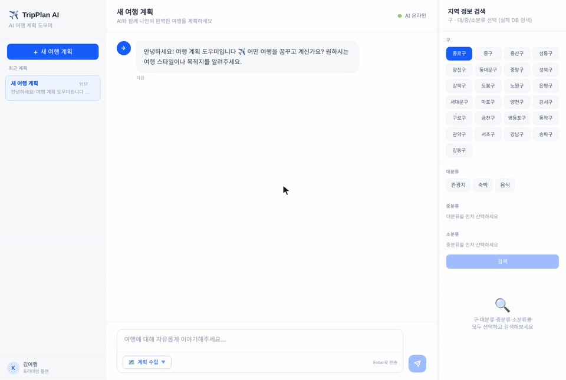
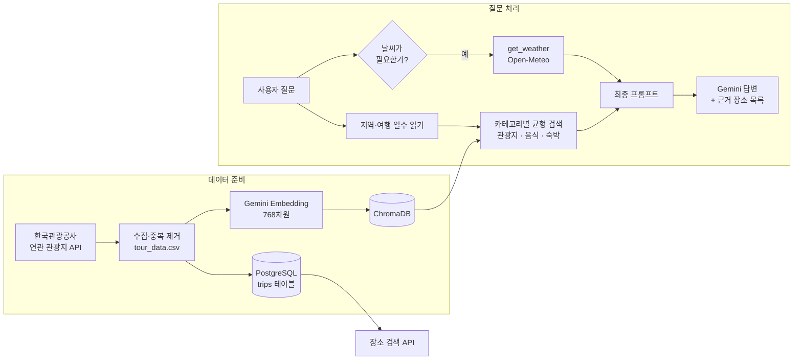

# Celestial Pathfinder · 서울 여행 코스 추천 AI

질문 한 줄로 서울 여행 코스를 짜 주는 RAG 챗봇입니다.
"강동구 2박 3일 코스 짜줘"라고 물으면, 실제 공공데이터에서 관광지·음식점·숙소를 골라 일정으로 묶고 여행 기간의 날씨까지 함께 알려 줍니다.

SKKU × LS AI CAMPUS 1기 · 세 번째 미니 프로젝트



<br>

## 주요 기능

| 기능 | 설명 |
|---|---|
| 여행 코스 추천 챗봇 | 질문에서 지역(자치구)과 여행 일수를 읽어, 근거가 된 장소 목록과 함께 일정을 답합니다 |
| 날씨 안내 | 질문에 날씨가 필요하면 LLM이 날씨 조회 도구를 직접 골라 부릅니다 (Function Calling) |
| 장소 검색 | 지역·대/중/소분류·이름으로 DB를 조건 검색합니다. 분류 목록은 DB에 있는 값만 보여 줍니다 |
| 여행 계획 수립 · PDF 저장 | 지역·날짜·여행 스타일·이동 수단을 골라 일정을 받고, 그 결과를 PDF로 내려받을 수 있습니다 |
| 대화 기록 | 대화는 브라우저에 저장되어 다시 열어 볼 수 있습니다 |

<br>

## 처리 흐름



<br>

## 데이터

| 항목 | 내용 |
|---|---|
| 출처 | 공공데이터포털 · 한국관광공사 연관 관광지 정보 (`TarRlteTarService1/searchKeyword1`) |
| 범위 | 서울특별시 25개 자치구, 기준 연월 2026년 7월 |
| 규모 | 중복 제거 후 2,449건 · 관광지 1,172 / 음식 1,028 / 숙박 249 |
| 수집 방식 | 자치구 × 검색 키워드(한국어·영어) 조합으로 API를 반복 호출해 모은 뒤 중복을 제거 |

한 행은 "기준 관광지 → 함께 방문한 연관 장소"의 관계와 연관 순위, 3단계 분류(대/중/소)를 담고 있습니다.

<br>

## RAG 설계

단순히 질문과 가까운 문서 k개를 가져오면, 한 카테고리(예: 음식점)만 잔뜩 나오고 숙소가 빠지는 일이 생겼습니다. 여행 일정에는 세 종류가 모두 필요하므로 검색을 이렇게 나눴습니다.

- **카테고리별 균형 검색**: 관광지·음식·숙박을 따로 검색해 합칩니다.
- **여행 일수에 비례한 배분**: "2박 3일"을 읽어 관광지·음식은 하루 2곳씩(최대 8곳), 숙박은 1곳을 가져옵니다.
- **지역 필터와 대체 검색**: 질문에 자치구가 있으면 그 구로 좁히고, 그 구에 해당 카테고리가 없으면 지역 조건을 풀어 다시 찾습니다.
- **중복 제거와 출처 반환**: 같은 문서가 겹치지 않게 하고, 답변과 함께 근거 장소 목록(장소명·자치구·분류·거리)을 돌려줍니다.

임베딩은 `gemini-embedding-2`(768차원)를 쓰고, 문서 쪽은 제목을 붙인 문서 형식, 질문 쪽은 검색 질의 형식으로 따로 만들어 넣습니다.

<br>

## Function Calling

`get_weather` 도구 하나를 LLM에 알려 주고, 질문에 날씨가 필요할 때만 LLM이 직접 호출하게 했습니다(`tool_choice: auto`).

- 도시 이름을 좌표로 바꾼 뒤 Open-Meteo에서 여행 기간의 예보를 가져옵니다.
- 예보 범위를 벗어난 날짜는 계절 평균 날씨로 안내하고, 외부 API가 실패하면 오류 종류와 재시도 가능 여부를 함께 돌려줍니다.

<br>

## 기술 스택

| 영역 | 사용 기술 |
|---|---|
| LLM · 임베딩 | Gemini (`google-genai`), gemini-embedding-2 |
| 검색 | ChromaDB |
| 백엔드 | FastAPI, SQLAlchemy, PostgreSQL |
| 데이터 수집 | requests, pandas |
| 프론트엔드 | React 19, Vite, TypeScript, Tailwind CSS, react-markdown |

<br>

## 폴더 구조

```
celestial-pathfinder-curation-core/
├── backend/app/
│   ├── api/            # /api/chat, /api/search, /api/categories
│   ├── tools/          # Function Calling (get_weather)
│   ├── chat_service.py # RAG + 도구 결과를 합쳐 최종 답변 생성
│   ├── prompts.py
│   └── llm.py          # Gemini 호출 공통 함수
├── src/
│   ├── rag.py          # 카테고리별 균형 검색, Context 생성
│   ├── retriever.py · vector_store.py · embedding.py · documents.py
│   └── trip_search/    # 장소 조건 검색 (DB), 공공데이터 API 수집
├── scripts/build_vector_db.py
├── data/
│   ├── output/tour_data.csv
│   ├── sql/create_database.sql
│   └── load_base_data.py
└── front/              # React 화면
```

<br>

## 실행 방법

준비물: Python 3.11 이상, PostgreSQL, Node.js와 pnpm, Gemini API 키

```bash
# 1. 설정
cp .env.example .env      # GEMINI_API_KEY, PG* 값 채우기
pip install -r requirements.txt sqlalchemy

# 2. DB 만들기: data/sql/create_database.sql을 DB 도구에서 먼저 실행 (.env의 PGDATABASE=trip_database)
python -m data.load_base_data        # 스키마·테이블 생성, CSV 적재 (처음 한 번)

# 3. 벡터 DB 만들기 (--limit 50 처럼 일부만 넣어 시험할 수 있음)
python scripts/build_vector_db.py

# 4. 백엔드 (http://localhost:8000/docs)
cd backend && uvicorn app.main:app --port 8000

# 5. 프론트엔드 (http://localhost:8443)
cd front && pnpm install && pnpm dev
```

데이터를 새로 받으려면 `.env`에 `OPEN_API_KEY`(공공데이터포털 키)를 넣고 `python src/trip_search/openAPI/get_openAPI_data.py`를 실행합니다.

<br>

## API

| 메서드 | 경로 | 하는 일 |
|---|---|---|
| POST | `/api/chat` | 질문을 받아 답변, 근거 장소 목록, 도구 실행 결과를 반환 |
| POST | `/api/search` | 지역·분류·이름 조건으로 장소 검색 (페이지 단위) |
| GET | `/api/categories` | DB에 있는 대/중/소분류 조합 목록 |
| GET | `/health` | 서버 상태 확인 |

<br>

## 한계와 다음 단계

- 데이터가 서울, 2026년 7월 한 달치라 다른 지역·시기 질문에는 답이 약합니다.
- 추천 품질을 숫자로 재는 평가 세트가 아직 없습니다. 다음 단계로 시험 질문을 만들어 "질문한 자치구와 맞는 결과 비율", "세 카테고리가 모두 포함된 비율"을 일반 검색과 비교하려 합니다.
